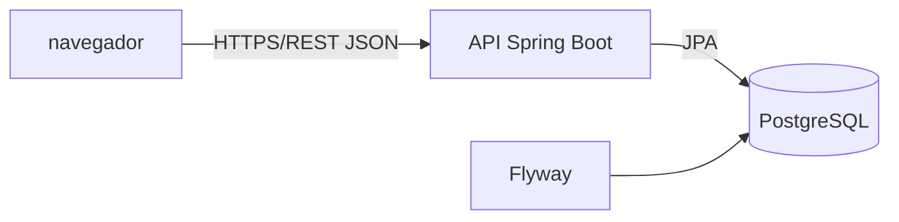

# HLD: Controle financeiro pessoal — C1
Versão: 1 | Data: 2026-11-05 | Responsável: Yoda (C1)

## Objetivo técnico
Organizar a aplicação full-stack exigida pela [especificação comum](../../../experiment/specification.md), mantendo autenticação, dados financeiros e exportações sob autorização por usuário. Este documento registra o desenho e a implementação observada em C1; evidências de comportamento e seus limites constam de `docs/verificacao.md` e `evidences/`. A implementação é candidata e aguarda segunda rodada independente; este status não representa aceite.

## Arquitetura geral

O frontend React com TypeScript apresenta os fluxos de autenticação, dashboard e movimentações. O backend Java/Spring Boot expõe a API REST e aplica validação, autenticação, autorização e regras financeiras. PostgreSQL é a fonte persistente dos usuários, credenciais de autenticação, movimentações e, se necessário ao mecanismo escolhido, estado de revogação de tokens. Flyway versiona alterações de schema; Spring Data JPA faz a persistência. A stack decorre da especificação. Hospedagem e topologia além da execução local estão em **LACUNA**.

## Componentes e responsabilidades

| Componente | Responsabilidades | Dependências |
|---|---|---|
| Frontend React/TypeScript | Telas e formulários; envio de credencial/token; apresentação de listagem, resumo e estado de operação. Não persiste token em `localStorage`. | API REST |
| API de autenticação | Cadastro, login, identidade autenticada e logout com revogação efetiva. Hash de senha adequado e normalização/validação de e-mail. | PostgreSQL; PostgreSQL e bearer opaco persistido por hash |
| API de movimentações | CRUD, filtros, ordenação, paginação e resumo; restringe cada consulta e mutação ao usuário autenticado. | Autenticação; persistência JPA/PostgreSQL |
| Serviço de exportação | Gera PDF e XLSX com a seleção completa dos mesmos filtros e totais, limitada ao usuário autenticado. | API de movimentações; PDFBox 3.0.6 e Apache POI 5.4.1, com paginação de consulta e saída em fluxo |
| PostgreSQL e Flyway | Persistência transacional e evolução versionada do schema. | API/JPA; migrações Flyway |

As fronteiras são responsabilidades lógicas dentro da API; não há requisito que justifique serviços implantáveis separados.

## Fluxos de requisição e dados

- Cadastro/login validam e normalizam os campos, consultam ou gravam usuário e credencial protegida e emitem token. Logout revoga o token; chamadas privadas validam sua validade e revogação.
- Toda chamada privada resolve a identidade a partir da autenticação. O identificador do proprietário vem dessa identidade, nunca do payload. Consultas, updates, exclusões, resumo e exportações aplicam conjuntamente proprietário e filtros; recurso ausente ou de outro usuário resulta em 404 conforme contrato.
- Listagem aplica filtros combináveis e ordenação estável, pagina apenas o resultado e devolve `content`, total e parâmetros de paginação. Resumo usa a mesma seleção autorizada sem paginação. Exportações reaproveitam a mesma semântica de filtros e totais, sem depender da página atual.
- Valores monetários são decimais exatos e transmitidos como strings; datas são datas locais ISO sem conversão por timezone. Entradas e saídas derivam o saldo; não se mantém saldo redundante como fonte da verdade.

## Modelo de dados em alto nível

- **User**: identidade, nome, e-mail normalizado e hash de senha.
- **Transaction**: proprietário obrigatório, tipo, descrição, categoria livre, valor decimal positivo, data e timestamps. O proprietário referencia User; índices devem atender consultas por proprietário e filtros/ordenação usados, definidos após implementação e evidência de consulta.
- **Token/revogação**: estado persistido somente se necessário à estratégia de token selecionada para garantir expiração e revogação efetiva no logout. Retenção e limpeza são **LACUNA**.

A especificação não exige entidade separada para categoria: categoria é nome validado associado à movimentação. Movimentações autorizadas são a fonte do cálculo de resumo e saldo.

## Interfaces públicas

| Nome | Tipo | Protocolo | Exposição | Limites/SLAs |
|---|---|---|---|---|
| `/api/auth/*` | REST JSON | HTTP; bearer token nas rotas privadas | Cliente web | Contrato comum; sem SLA definido |
| `/api/transactions` e `/{id}` | REST JSON | HTTP; bearer token | Usuário autenticado, sempre limitado ao proprietário | page ≥ 0; size 1–100; parâmetros e erros conforme protocolo; sem SLA definido |
| `/api/transactions/summary` | REST JSON | HTTP; bearer token | Usuário autenticado e proprietário | Mesmos filtros da listagem, sem paginação; sem SLA definido |
| `/api/transactions/export.pdf`, `/export.xlsx` | PDF/XLSX | HTTP; bearer token | Usuário autenticado e proprietário | Todos os registros selecionados; sem SLA ou limite de volume definido |

Métodos, payloads, status e filtros detalhados são os do contrato REST em `experiment/protocol.md`.

## Escalabilidade e disponibilidade
Sem metas de carga, disponibilidade, latência ou implantação na especificação: **LACUNA**. A proposta mantém API e banco como componentes simples no ambiente local previsto; não assume réplicas, cache ou filas.

## Segurança
A implementação usa bearer opaco com expiração de 12 h e revogação persistida, senha BCrypt custo 12 e token somente em memória no frontend. Consultas e mutações financeiras derivam proprietário do bearer; smoke local verificou isolamento entre dois usuários e logout revogável. A segunda revisão Neo independente ainda não foi concluída. A varredura OSV C1 pós-A-002 reportou dois advisories para Spring WebMVC 6.2.19, preservados abertos até triagem de reachability; o gate Java não está verde.

## Observabilidade
Eventos de experimento e fases seguem o protocolo central; isso não define logging operacional da aplicação. Formato, retenção, métricas operacionais e correlação HTTP são **LACUNA**, pois a especificação não estabelece metas ou ferramentas. Não registrar senhas, tokens ou conteúdo financeiro sensível em logs.

## Riscos arquiteturais

| Risco | Probabilidade / impacto | Mitigação | Contingência |
|---|---|---|---|
| Consulta ou exportação esquecer o filtro de proprietário | Média / Crítico | Centralizar identidade autenticada e aplicar escopo do proprietário em cada operação; validar isolamento por testes independentes. | Bloquear aceite e corrigir antes da entrega. |
| Logout não invalidar token já emitido | Média / Alto | Selecionar estratégia que permita revogação efetiva, cobrir ciclo de vida do token por testes. | Invalidar sessões existentes e ajustar mecanismo antes do aceite. |
| Semântica divergente entre lista, resumo e exportação | Média / Alto | Compartilhar especificação/implementação da seleção filtrada, com ordenação e limites definidos pelo contrato. | Corrigir a seleção comum e repetir validações pertinentes. |
| Exportação de volume elevado exceder recursos | Indeterminada / Médio | Não há limite de volume nem meta definida; observar consumo durante validação. | Registrar limitação e propor limite somente se evidência exigir decisão de produto. |

## ADRs e próximos passos
[ADR-001](adr/ADR-001-implementacao.md) registra as decisões implementadas para token revogável e exportações, aguardando revisão independente. O HLD estabelece fronteiras; detalhes de classes permanecem no código.

## Decisões da implementação C1

A sessão usa tokens opacos aleatórios de 256 bits, expiração de 12 horas e armazenamento somente do SHA-256 no banco. Cada requisição valida token não revogado e não expirado; logout grava `revoked_at`. O cliente mantém token apenas em memória, sem `localStorage`. Senhas usam BCrypt com custo 12.

PDF é gerado por PDFBox 3.0.6 e XLSX por Apache POI 5.4.1. Ambos consultam a seleção completa filtrada e autorizada do serviço de movimentações, com valores e totais. Spring Data JPA persiste usuários, tokens e movimentações; Flyway cria o schema inicial. A exportação PDF usa a fonte base PDF e substitui caracteres não ASCII para manter renderização previsível; isso limita acentos no arquivo exportado.

O Compose publica a aplicação local em `localhost:5173` e API em `localhost:8080`; o Nginx encaminha `/api` para a API. A senha local do PostgreSQL é obrigatória via `.env`, não há valor padrão versionado. O banco persiste em volume nomeado.

Build/testes locais e smoke Compose foram executados conforme `docs/verificacao.md`. Revisões independentes, pentest e gate Java de segurança permanecem pendentes; OSV reportado pelo Oráculo encontrou 23 achados transitivos aguardando Neo. `npm audit` está limpo com Vitest 4.1.12.

### Emenda comum A-001

A-001 (2026-11-06) atualizou os pins efetivos para Spring Boot 3.5.16, Vite 7.3.7 e PostgreSQL 17.11 em todos os cenários, após identificação de advisories na baseline inicial. Esta alteração ocorreu durante o código de C1 e seu custo é retrabalho induzido pela intervenção comum.

### Atualização do runner de testes

A auditoria npm identificou advisories no Vitest 3.2.4 e na árvore `@vitest/mocker`/`tinypool` (incluindo risco crítico de execução de código). O patch 3.2.7 ainda deixava três achados. Vitest 4.1.12 removeu os achados na auditoria (`npm audit` sem vulnerabilidades) e passou a suíte/build em Node 24 e Vite 7.3.7. Essa atualização major é somente ferramenta de testes/desenvolvimento, não muda a versão do runtime React/Vite no protocolo; o custo de investigação e ajuste pertence ao C1 e a paridade entre cenários permanece decisão do Oráculo.

### Risco de dependências Java aberto

O Oráculo reportou uma varredura OSV independente com 23 achados transitivos (7 críticos, 7 altos, 9 moderados), incluindo Tomcat 10.1.55, Jackson 2.21.4, Commons Lang 3.17, Log4j 2.24.3, PostgreSQL JDBC 42.7.11 e Spring WebMVC 6.2.19. A lista e severidades aguardam revisão independente do Neo. Não alteramos versões transitivas ou major do baseline neste cenário; a API Dependency-Check local permanece bloqueada sem configuração `DEPCHECK_VERSION` e chave NVD. O gate de segurança não está verde e o candidato não está aprovado.

### Remediação C1 e A-002

Filtros são aplicados em consulta paginada com casts explícitos para parâmetros opcionais no PostgreSQL; listas, resumo, PDF e XLSX compartilham os mesmos predicados e escopo do proprietário. Exports transmitem sem truncamento e limitam concorrência a duas operações por instância; detalhes e trade-offs estão em ADR-001. Login/cadastro aplicam rate limit por IP com TTL e armazenamento limitado. A emenda A-002 atualizou Jackson BOM, Commons Lang, Log4j2, Tomcat e JDBC; Spring Boot 3.5.16/Spring Framework 6.2.19 permanecem fixos. Revisões independentes delta estão pendentes e o gate de segurança Java não está verde.
